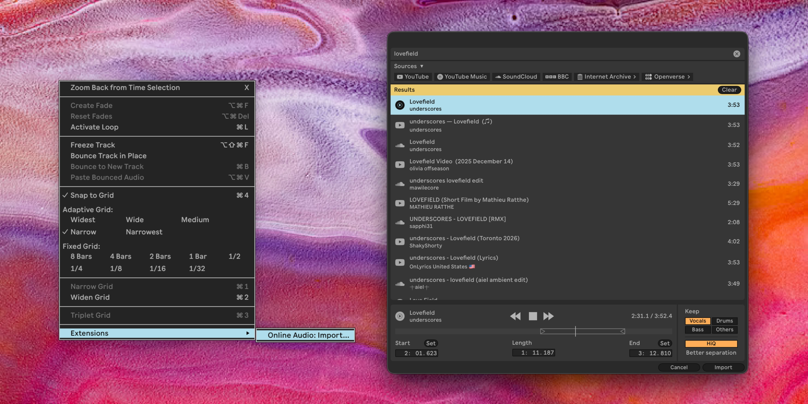

# Online Audio for Ableton Live

**Find and import online audio without leaving Ableton Live.**

Online Audio searches YouTube, YouTube Music, SoundCloud, BBC Sound Effects, Internet Archive, and Openverse audio (Freesound, Jamendo, Wikimedia Commons) inside Ableton Live. Preview and trim a result, then import the full track or selected range into a clip slot, an Arrangement track, or Simpler.

<p align="center">
  <a href="../../releases/latest/download/Online-Audio.ablx"><strong>Download extension (.ablx)</strong></a>
</p>

> Requires **Ableton Live 12.4.5 public beta** with Extensions.

<p align="center">
  
</p>

## Demo

https://github.com/user-attachments/assets/3a0104f0-5782-465e-b7a9-4da79ca42807

## How to use

1. Right-click a clip slot, an Arrangement selection, an audio track, or a Simpler device.
2. Choose **Extensions → Online Audio: Import…**
3. Search for a song or sound effect, or paste a YouTube, YouTube Music, SoundCloud, or Internet Archive URL. Openverse results are opt-in under the Openverse source chip (expand for Freesound, Jamendo, or Wikimedia).
4. Pick a result to preview it.
5. (Optional) Drag the timeline's **Start** and **End** handles to select a range.
6. (Optional) Choose stems to keep — **Vocals**, **Drums**, **Bass**, **Others**. Turn on **HiQ** for higher-quality separation (off by default = faster). Leave all stems off to import the full mix.
7. Click **Import**. Live places the audio in the selected target.

## Install

1. [Download the extension](../../releases/latest/download/Online-Audio.ablx).
2. Open Live's **Settings**.
3. Select the **Extensions** tab.
4. Drag `Online-Audio.ablx` into the **Drag and drop to install** area.
5. Turn off **Developer Mode** if it is enabled.
6. Quit and reopen Live.

Packaged extensions do not appear while Developer Mode is active.

## Requirements

- Ableton Live 12.4.5 public beta with Extensions

On the first import, the extension downloads managed `yt-dlp` and verified FFmpeg binaries into Live's extension storage (about 69-88 MB combined, depending on the platform). Both downloads are automatic.

Stem separation picks a model by what you keep:

| Selection | HiQ off (default) | HiQ on |
|---|---|---|
| **Vocals only** (or Drums+Bass+Others) | MDX `Kim_Vocal_2` via [audio-separator](https://github.com/nomadkaraoke/python-audio-separator) | BS-RoFormer |
| **Drums / Bass / Others / mixed stems** | HTDemucs via [demucs-rs](https://github.com/nikhilunni/demucs-rs) | HTDemucs fine-tuned |

The first vocals/instrumental stem import installs a managed Python tool stack with `uv` + `audio-separator` into Live's extension storage (large first-time download; models cache under `models/audio-separator`). Other stem mixes download managed demucs-rs (~10 MB) plus HTDemucs weights (~84 MB High Speed / ~333 MB High Quality, system cache). Separation runs locally.

The extension checks `yt-dlp` for updates about once a day; pinned tool versions update with the extension.

## Use audio responsibly

Download only audio you have permission to use. Follow copyright law and each source's terms of service.

BBC Sound Effects audio is available under the BBC RemArc licence for non-commercial personal, research, and formal education use. Commercial use requires a separate licence from Pro Sound Effects. BBC metadata is licensed separately under the Open Government Licence 3.0.

Internet Archive items each carry their own rights statement. Confirm the item page licence before reuse.

Openverse results are openly licensed works from Freesound, Jamendo, and Wikimedia Commons. Each item has its own Creative Commons (or similar) licence — check attribution and commercial-use terms before reuse. Freesound audio via Openverse is typically the HQ preview stream, not the original upload.

<details>
<summary><strong>Development and packaging</strong></summary>

### Set up

Get the Ableton Extensions SDK tarballs described in [`vendor/README.md`](vendor/README.md), then run:

```bash
npm install
cp .env.example .env
# Set EXTENSION_HOST_PATH in .env to your Live Beta application.
# In Live, enable Preferences → Extensions → Developer Mode.
npm start
```

The SDK tarballs are proprietary and must not be redistributed.

### Build a package

```bash
npm run package
```

The package command produces a versioned `Online-Audio-<version>.ablx` file.

### Publish a download

Attach the build to a GitHub Release with the asset name `Online-Audio.ablx`. The download links at the top of this README always target that file in the latest release.

</details>

## Open source

The source code is available under the [MIT License](LICENSE).

Managed [FFmpeg](https://ffmpeg.org/) binaries come from [Shaka Project's reproducible builds](https://github.com/shaka-project/static-ffmpeg-binaries) and are licensed separately under the GPL. Their version, checksum, source, and license information are saved beside the downloaded binary.

Managed [demucs-rs](https://github.com/nikhilunni/demucs-rs) binaries are licensed separately under the Apache License 2.0. Their version, checksum, source, and license information are saved beside the downloaded binary.

Vocal models run through [audio-separator](https://github.com/nomadkaraoke/python-audio-separator) (MIT), installed with [uv](https://github.com/astral-sh/uv). Model weights come from the UVR / community model ecosystem and are downloaded on first use.
